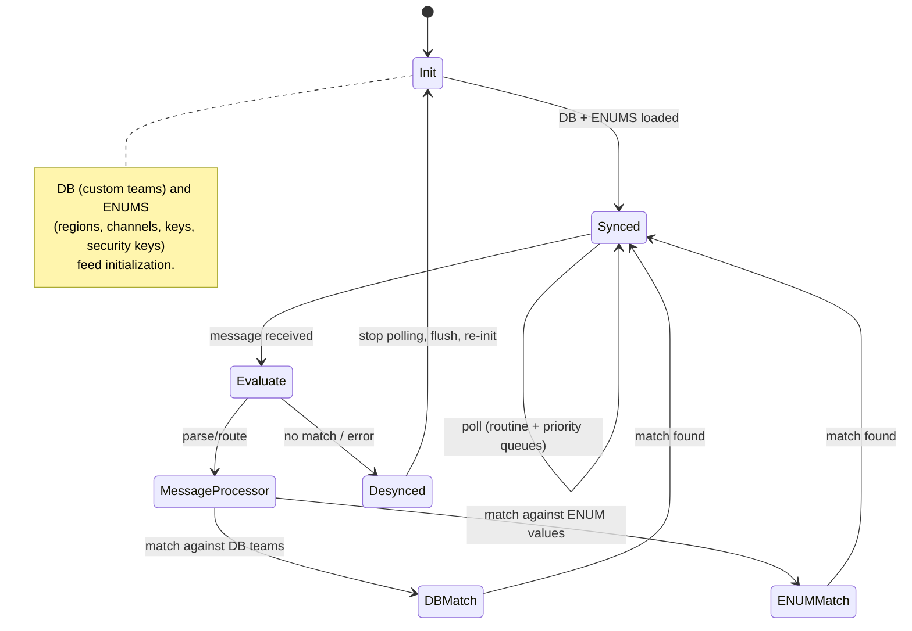

# Future Phases & Integration Hooks

Everything here is **out of scope for the current phase** but is documented so the
current schema and code stay compatible with it.

Bluetooth sync, active-team detection, joining a team on the headset, and the
headset-reported region are implemented — see [ble-protocol.md](ble-protocol.md)
and [region-rules.md](region-rules.md).

## Open headset work

- **LTC override behavior** — override built-in "loaded team channel" (LTC) teams
  on the headset. Behavior is not yet defined.
- **Headset-driven `is_locked`** — the `is_locked` flag on `teams` is the hook for
  active-team protection. It is stored, but nothing sets it from headset state.
- **Validation against the headset's zone** — new teams take their region from
  the locally persisted selection, not from the connected headset.

## Headset-variant gating (dropped)

Custom teams were originally specified as exclusive to the **1004257 Flagship**
headset, with the 1004058 Base variant excluded. The app carried a placeholder
gate and a `DEV_NO_GATE` compile-time bypass for local testing.

**Gentex removed this requirement.** Custom teams are available on every AMP 2.0
headset, and the gate has been removed rather than wired to real hardware
detection. The part number is still read over BLE, but only to detect region
locking — nothing branches on the variant.

## `customSecurityKey` (reserved)

Reserved nullable schema field only. No UI, no generation, not in QR payloads, not
required on import. A future phase may introduce passphrase-derived AES-256 custom
keys once Android implements them and the product team green-lights it; the schema
column and the QR contract's versioning room already accommodate that.

## Android headset sync state machine (reference context)

Documented so the iOS persistence model stays compatible with the eventual
Bluetooth sync design. This is **reference only** — not implemented on iOS now.

Flow summary:

1. **Init** — the local **DB** (custom teams) and the **ENUMS** (regions, RF
   channels, predefined security keys) feed initialization.
2. **Synced** — steady state; the app polls the headset via **routine** and
   **priority** message queues.
3. **Message Processor** — incoming messages are parsed and routed.
4. **Evaluate** — the processed message is compared against known state:
   - **DB Match** — matches a stored custom team.
   - **ENUM Match** — matches a known enum value (region/channel/key).
5. **Desynced** — on a failed match or error, **stop polling and flush**, then
   return to **Init** to re-synchronize.

### Why the current schema is compatible

- Custom team data (`teams`) is kept **separate** from any headset-derived state,
  so the "DB Match" step can read teams without schema changes.
- The predefined enums (`Region`, `SecurityKey`, RF channel ranges) already model
  the "ENUM Match" inputs.
- The `is_locked` flag reserves space for active-team/locked behavior that headset
  sync will eventually drive.
- Region is a replaceable interim value, so a headset-reported region slots in
  without reshaping the schema.

## Explicitly out of scope (this phase)

- Full-database import/export as a file.
- Cloud sync, accounts, OAuth, remote key management.
- User-facing custom AES-256 security-key authoring.
- A FIPS 140-3 validated cryptographic module (see [decisions.md](decisions.md)).
